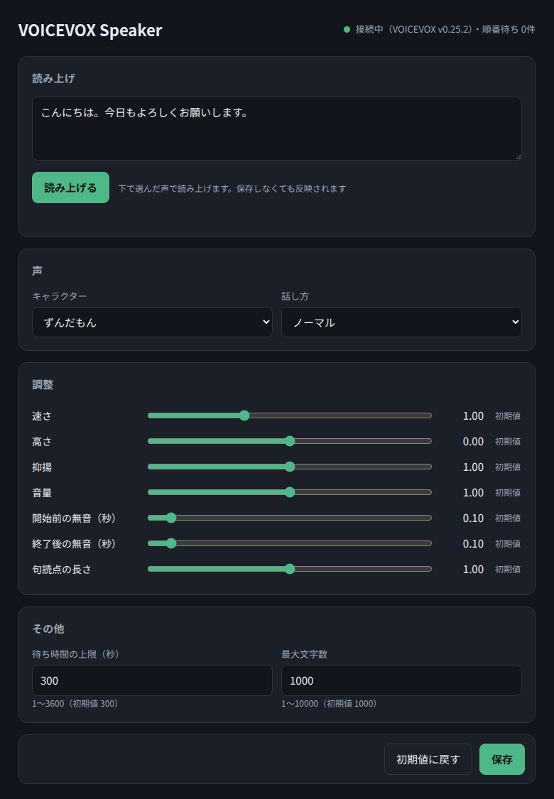

# Web 画面

ブラウザで `http://<host>:8080/` を開くと、声や設定を変えるための画面が出ます。

## できること

| 場所 | できること |
|---|---|
| 読み上げ | 文章を入れて「読み上げる」を押すと読み上げる。`Ctrl+Enter` でも読み上げる |
| 声 | キャラクターと話し方を選ぶ |
| 調整 | 速さ・高さ・抑揚・音量・開始前／終了後の無音・句読点の長さをスライダーで変える。「初期値」でその項目だけ初期値に戻る |
| その他 | 待ち時間の上限と、最大文字数を変える |
| 保存 | 今の画面の内容を「いつもの設定」にする |
| 初期値に戻す | すべての設定を初期値に戻す |

## 試し聞きと保存の違い

- **読み上げる** は、画面で選んでいる声と調整で読み上げます。保存していなくても反映されるので、気軽に試せます
- **保存** すると、API で `speaker` などを省略したときにも、その声と調整が使われるようになります

保存していない変更があると、画面の下に「● 未保存の変更があります」と出ます。

保存した設定は `data/settings.json` に書き込まれ、再起動しても残ります。

## 画面から変えられない設定

次の設定は `.env` に書きます（[設定](configuration.md)）。

- ポートやエンジンの URL（変えると再起動が必要になるため）
- 再生コマンド（画面から書き換えられると、サーバーで好きなコマンドを実行できてしまうため）
- 合言葉

## 合言葉を設定している場合

画面を開くと合言葉の入力欄が出ます。入力した合言葉はブラウザに保存され、次からは入力しなくても使えます。
